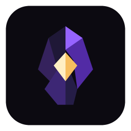
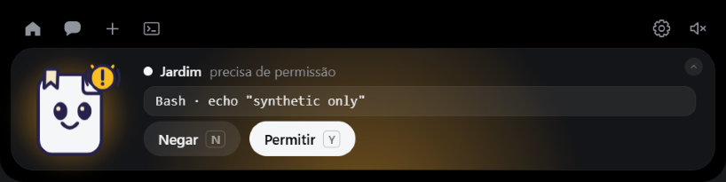
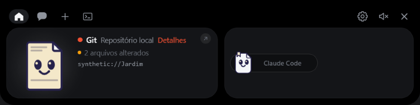
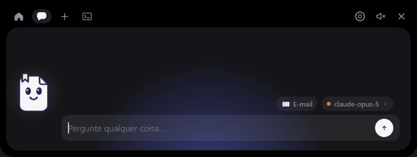
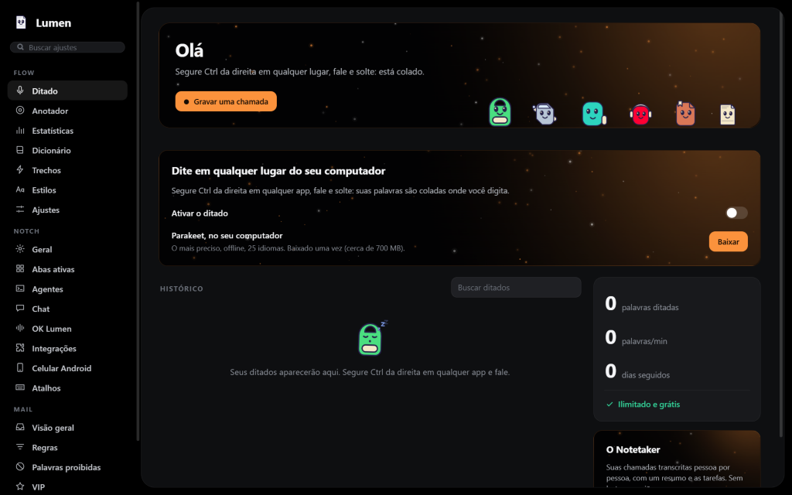
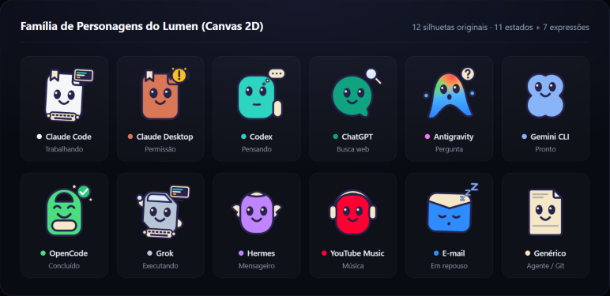
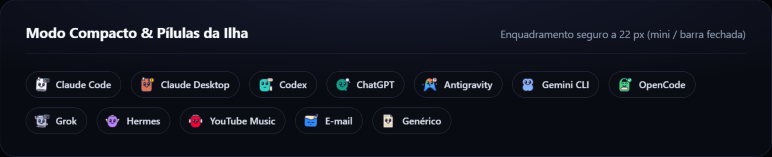
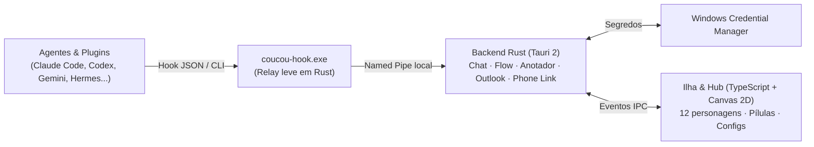

<div align="center">



# Lumen

**Ilha flutuante inteligente para Windows que acompanha seus agentes de IA, permissões, ditado offline, anotações e integrações sem tirar você do foco.**

<p>
  <a href="https://github.com/playertwo1/lumen/releases/tag/windows-v0.7.4"></a>
  <a href="https://github.com/playertwo1/lumen/releases/download/windows-latest/Lumen-Windows-setup.exe"></a>
  
  
  <a href="LICENSE"></a>
</p>

<p>
  <a href="#-instalar"><strong>Instalar</strong></a> ·
  <a href="#-recursos"><strong>Recursos</strong></a> ·
  <a href="#-família-de-personagens-canvas-2d"><strong>Personagens</strong></a> ·
  <a href="#-agentes-e-integrações"><strong>Agentes</strong></a> ·
  <a href="#-arquitetura"><strong>Arquitetura</strong></a> ·
  <a href="#-compilar-do-código-fonte"><strong>Compilar</strong></a> ·
  <a href="#-licença-e-créditos"><strong>Licença</strong></a>
</p>

<br>



<table>
  <tr>
    <td width="50%" align="center">
      
      <br><sub><b>Sessão ao vivo + Pílula Git</b></sub>
    </td>
    <td width="50%" align="center">
      
      <br><sub><b>Chat multi-provedor na ilha</b></sub>
    </td>
  </tr>
</table>

</div>

---

## ✨ Por que o Lumen?

Enquanto você programa ou trabalha no Windows, seus agentes de IA pedem permissões, editam arquivos, executam builds e esperam respostas em abas perdidas pelo terminal. O **Lumen** coloca uma ilha discreta e transparente na borda superior da tela — sem roubar o foco da janela atual — para você enxergar o que importa e agir em segundos.

> [!NOTE]
> **Lumen** é a evolução para Windows (lado desktop da **Segunda Mente**) criada a partir do código aberto MIT de [Louis-CFM/coucou](https://github.com/Louis-CFM/coucou). Para macOS, iPhone, Linux e a versão original do Coucou, consulte o repositório upstream e o arquivo [LICENSE-ASSETS.md](LICENSE-ASSETS.md).

---

## 📥 Instalar

Baixe o instalador para **Windows 10 / 11** diretamente das releases de [`playertwo1/lumen`](https://github.com/playertwo1/lumen/releases/tag/windows-latest):

| Instalador | Escopo | Link direto |
|---|---|---|
| **Setup do usuário (`.exe`)** | Instala apenas para o usuário atual (sem exigir admin) | [`Lumen-Windows-setup.exe`](https://github.com/playertwo1/lumen/releases/download/windows-latest/Lumen-Windows-setup.exe) |
| **Instalador de sistema (`.msi`)** | Instalação padrão Windows Installer | [`Lumen-Windows.msi`](https://github.com/playertwo1/lumen/releases/download/windows-latest/Lumen-Windows.msi) |

> [!TIP]
> Os instaladores ainda não possuem certificado Authenticode, então o SmartScreen pode exibir aviso de editor desconhecido; clique em **Mais informações → Executar mesmo assim**. Após instalar, novas versões podem ser verificadas em **Ajustes → Geral → Atualizações** com conferência de SHA-256.

<details>
<summary><b>Histórico recente de versões do Lumen (Windows)</b> — ver destaques de <code>0.6.13</code> a <code>0.7.4</code></summary>

| Versão | Data | Destaques |
|---|---|---|
| [`windows-v0.7.4`](https://github.com/playertwo1/lumen/releases/tag/windows-v0.7.4) | 15 nov. 2026 | Integração Google no Lumen com Drive/Calendar (`L7`), Notch compacto 2A e aba de tarefas na ilha, redesign editorial do Hub (Etapas 1–4) e chat em grupo com até 15 personas nas notas |
| [`windows-v0.7.3`](https://github.com/playertwo1/lumen/releases/tag/windows-v0.7.3) | 15 nov. 2026 | Pareamento via relay com a Segunda Mente (`L6.2`), sync E2EE de tarefas pela caixa de correio (`L6.3`), cancelamento cruzado de avisos e animação P3 (`L6.4`) |
| [`windows-v0.7.2`](https://github.com/playertwo1/lumen/releases/tag/windows-v0.7.2) | 14 nov. 2026 | Tarefas com captura `Ctrl+Alt+K` e WinRT Toast (`L4`), e-mail MailCraft/Outlook sem envio automático (`L5`), caixa persistente E2EE no relay (`L6.1`) e heróis Lumen no Hub |
| [`windows-v0.7.1`](https://github.com/playertwo1/lumen/releases/tag/windows-v0.7.1) | 14 nov. 2026 | 15 personas oficiais da Segunda Mente com avatares e Tavern (`L3.2`), sync via celular Android (ADB) e personagens Grok, Hermes Desktop e ajustes no Canvas |
| [`windows-v0.7.0`](https://github.com/playertwo1/lumen/releases/tag/windows-v0.7.0) | 14 nov. 2026 | Anotador só no microfone e texto rápido (`L3.1`), comentários locais de personas com `@menção` (`L3.2`), animação P3 e identidade `playertwo1/lumen` |
| [`windows-v0.6.18`](https://github.com/playertwo1/lumen/releases/tag/windows-v0.6.18) | 14 nov. 2026 | Personagens sem corte vertical e com modo mini/compacto; transição para o repositório próprio `playertwo1/lumen` |
| `windows-v0.6.17` | 14 nov. 2026 | Busca web e contexto de data/cidade configurável no chat via Plano ChatGPT |
| `windows-v0.6.16` | 14 nov. 2026 | Divisão de tokens longos no **Windows Credential Manager** para estabilizar login ChatGPT |
| `windows-v0.6.15` | 14 nov. 2026 | Chat no Plano ChatGPT sem chave de API paga e animações P1/P2 em Canvas 2D |
| `windows-v0.6.14` | 13 nov. 2026 | Login OAuth ChatGPT via navegador salvo com segurança no cofre do Windows |
| `windows-v0.6.13` | 13 nov. 2026 | Primeira versão com identidade própria Lumen (Bússola de papel) e migração de ajustes/hooks |

Consulte também o [CHANGELOG.md](CHANGELOG.md) e o guia de plataforma em [`windows/README.md`](windows/README.md).

</details>

---

## ⚡ Recursos

<div align="center">
  
</div>

<br>

- ✅ **Aprovações e perguntas na ilha:** aprove (`Permitir`), bloqueie (`Negar`) ou responda perguntas estruturadas do **Claude Code**, **Codex** e outros agentes sem trocar de janela.
- 📝 **Diffs ao vivo e pílula Git:** acompanhe cada alteração de arquivo com contagem `+N −M`, inspecione o diff completo e veja na pílula Git o branch atual, arquivos alterados e commits à frente/atrás.
- 🧪 **Status de build e testes locais:** observe automaticamente na sessão o resultado de execuções locais (`npm test` e `cargo build`) sem inundar o painel com logs.
- 💬 **Chat integrado e Plano ChatGPT:** converse usando **Plano ChatGPT** (OAuth no navegador com busca web e localização opcional), **Anthropic**, **Google AI**, **OpenAI**, **Ollama**, **LM Studio** ou pelas próprias CLIs assinadas na máquina.
- 🎙️ **Flow (ditado offline) e Anotador:** segure `Ctrl` da direita em qualquer app para ditar com **Parakeet** offline ou use `Ctrl+Alt+I` para registrar ideias rápidas com comentários locais de personas (`@menção`).
- 🔌 **Serviços, e-mail e celular:** acompanhe GitHub, GitLab/Gitea, Vercel, Stripe, n8n, Resend, Notion, Cal.com, Outlook clássico, YouTube Music, WhatsApp (via gateway local opcional) e ligação local por Wi-Fi com [Android](android/README.md).
- 🔒 **Privacidade por padrão:** zero telemetria; credenciais e tokens ficam somente no **Windows Credential Manager**, nunca em texto plano no repositório. Nada (e-mail, mensagem ou aprovação) sai sem clique explícito.

---

## 🎭 Família de Personagens (Canvas 2D)

Todos os personagens do Lumen são **originais** e desenhados em tempo real via **Canvas 2D** ([`compass-engine.ts`](windows/src/lumen/compass-engine.ts)), compartilhando grade lógica `96×96`, contorno `#26234B`, acentos contrastantes e pausa automática a **0 % de CPU** quando a ilha está oculta.

<div align="center">
  
  <br><br>
  
</div>

<br>

| Personagem | Identidade / Silhueta | Estados e Expressões |
|---|---|---|
| **Claude Code** & **Claude Desktop** | Folha de código com marcador · terracota para Desktop | 11 estados (`idle`, `working`, `thinking`, `searching`, `approval`, `question`, `error`, `finished`, `ratelimit`, `sleeping`, `dizzy`) |
| **Codex** & **ChatGPT** | Bloco ciano minimalista · balão conversacional verde | 7 expressões (`love`, `surprised`, `proud`, `wink`, `yawn`, `happy`, `annoyed`) + animações P1/P2/P3 |
| **Antigravity** & **Gemini CLI** | Arco em degradê vibrante · gêmeos arredondados azuis | Reações ao humor do sistema (CPU, temperatura, RAM, fadiga) |
| **OpenCode** & **Grok** | Cápsula verde de terminal · módulo espacial chanfrado grafite-prata | Física secundária (`lagX`, `lagY`), piscar e respeito a `prefers-reduced-motion` |
| **Hermes**, **YouTube Music**, **E-mail** & **Genérico** | Mensageiro alado · fones musicais · envelope · folha A4 | Enquadramento dedicado para modo mini/compacto (`22–32 px`) sem corte vertical |

---

## 🤖 Agentes e Integrações

A declaração de pílulas em [`windows/src/core/pills.ts`](windows/src/core/pills.ts) e o relay em [`windows/hook/`](windows/hook/) conectam múltiplos ecossistemas na mesma ilha:

| Categoria | Suportados no Windows | Como conecta |
|---|---|---|
| **Agentes e editores** | Claude Code, Cursor, Codex, Antigravity, Gemini CLI, Copilot CLI, Muse Code, OpenCode, Amp, Hermes, Claude Desktop, Grok | Hooks gerenciados em **Ajustes → Agentes** ou plugins locais (`coucou-hook.exe` via Named Pipe) |
| **Modelos no Chat** | Plano ChatGPT (OAuth), Anthropic, Google AI, OpenAI, Ollama, LM Studio, CLIs locais | Credenciais no **Windows Credential Manager** ou endpoint local (`127.0.0.1`) |
| **Serviços e fluxo** | Git local, GitHub, GitLab/Gitea, Vercel, Stripe, n8n, Resend, Notion, Cal.com, Outlook clássico, YouTube Music, WhatsApp (GOWA/OpenWA), Android LAN TLS | Opcional e sob demanda em **Ajustes → Integrações** |

Para adicionar um agente customizado com sua própria pílula via flag `--agent` ou payload de hook, consulte [`docs/AGENTS.md`](docs/AGENTS.md).

---

## ⌨️ Atalhos e Interações Rápidas

Todos os atalhos globais respeitam layouts `AltGr` (incluindo ABNT2 pt-BR) e podem ser alterados em **Ajustes → Atalhos**:

| Ação | Atalho padrão |
|---|---|
| Abrir o Chat de qualquer aplicativo | `Ctrl + Alt + Espaço` |
| Ir direto para a permissão ou pergunta pendente | `Ctrl + Alt + A` |
| Anotar ideia rápida por voz (Anotador) | `Ctrl + Alt + I` |
| Abrir janela do terminal da sessão ativa | `Ctrl + Alt + T` |
| Alternar entre pílulas da ilha | `Ctrl + Alt + ←` / `Ctrl + Alt + →` |
| Abrir nova sessão de agente | `Ctrl + Alt + L` |
| Alternar ilha aberta / recolhida | `Ctrl + Alt + N` |
| Ditar texto em qualquer campo (Flow) | Segurar `Ctrl` direito |

<details>
<summary><b>Gestos com o mouse na ilha e nos personagens</b></summary>

- **Passar o mouse no topo da tela:** o personagem espia na barra compacta.
- **Clicar na barra (ou ativar abrir ao passar):** expande a ilha completa.
- **Clicar / clicar 3× no personagem:** reage irritado e fica tonto (`dizzy`) por alguns segundos; descansar o ponteiro exibe expressão de carinho (`love`).
- **Arrastar um arquivo sobre a ilha:** anexa como contexto para o chat ou envia para o terminal da sessão escolhida.

</details>

---

## 🧭 Arquitetura



| Caminho | Conteúdo |
|---|---|
| [`windows/src-tauri/`](windows/src-tauri/) | Núcleo Rust (Tauri 2): ilha, chat, OAuth ChatGPT, `flow/`, `notes/` (Anotador e personas), `mail/`, `phone_link/`, cofre de segredos |
| [`windows/src/`](windows/src/) | Interface TypeScript: barra/ilha, hub de ajustes, catálogo de pílulas (`core/pills.ts`) e motor visual (`lumen/compass-engine.ts`) |
| [`windows/hook/`](windows/hook/) | Binário relay `coucou-hook.exe` com normalização de eventos de múltiplos agentes e zero bloqueio quando o app está fechado |
| [`windows/synthetic/`](windows/synthetic/) | Variante desktop e suíte isolada de validação sintética sem dados pessoais |
| [`docs/`](docs/) | Estado atual ([`STATE-FORK.md`](docs/STATE-FORK.md)), roadmap ([`ROADMAP-FORK.md`](docs/ROADMAP-FORK.md)), specs, planos e protocolos |
| [`relay/`](relay/), [`NotchBuddy/`](NotchBuddy/), [`android/`](android/) | Relay de notificações e código herdado macOS/Android |

---

## 🛠️ Compilar do Código-Fonte

**Pré-requisitos no Windows:** [Rust](https://rustup.rs), Node.js 20+ e MSVC Build Tools (Visual Studio C++ Build Tools).

```powershell
git clone https://github.com/playertwo1/lumen.git
cd lumen/windows
npm install
npm run pack        # gera o binário e instaladores em windows/release/
```

### Rodar checagens locais

```powershell
# TypeScript, testes unitários Node e build Vite (em windows/)
npx tsc --noEmit
npm test
npm run build

# Testes do backend Rust (em windows/src-tauri/)
cargo test --lib

# Testes do relay de hooks (em windows/hook/)
cargo test
```

> [!NOTE]
> Este repositório opera com foco em validação **100% local via CLI**; consulte [`CONTRIBUTING.md`](CONTRIBUTING.md) e [`docs/STATE-FORK.md`](docs/STATE-FORK.md) antes de propor mudanças.

---

## 📜 Licença e Créditos

- **Código-fonte:** licenciado sob a [Licença MIT](LICENSE). Código do app Windows/Linux e integrações originais preservam os devidos avisos de copyright (incluindo `@Rhytam23` no código Android e `phone_link` sob MIT).
- **Identidade visual e ativos do Lumen:** o nome **Lumen**, o ícone da Bússola de papel (`windows/src-tauri/icons/lumen/`) e os **12 personagens originais em Canvas 2D** (`windows/src/lumen/`) são ativos próprios do Lumen.
- **Ativos do upstream Coucou:** os nomes *Coucou* / *Mochi*, sons originais e mídias antigas em `NotchBuddy/` e `docs/media/` pertencem a **Louis Raillé** e **não** estão cobertos pela MIT — consulte [LICENSE-ASSETS.md](LICENSE-ASSETS.md) antes de redistribuir qualquer asset herdado.
- **Origem:** fork construído sobre o projeto [Louis-CFM/coucou](https://github.com/Louis-CFM/coucou), criado por [Louis Raillé](https://louisraille.fr), com contribuições da comunidade.
